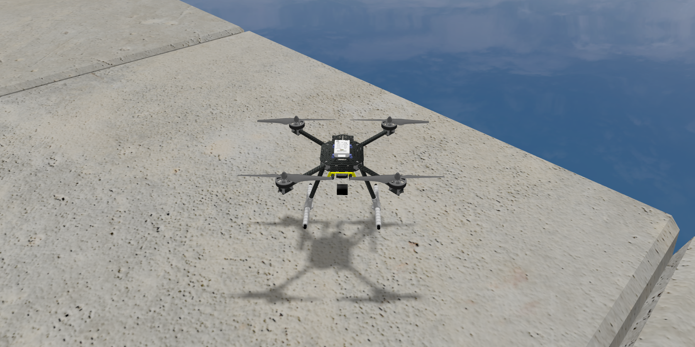
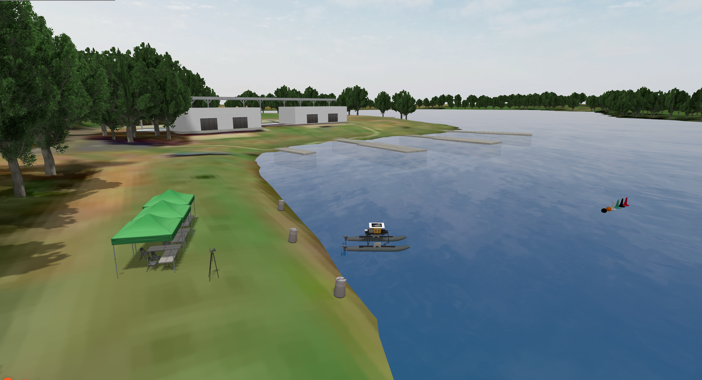
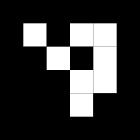

# Autonomous UAV Landing on a Moving Maritime Vessel

Autonomous landing of a PX4-controlled UAV on a WAM-V marker target in a VRX (Virtual RobotX) simulation, under configurable sea states and vessel motion.

<p align="center">
  
</p>

## Demo

### Stationary vessel

<!-- Paste the GitHub video link for the stationary landing here (on its own line) -->

### Moving vessel

<!-- Paste the GitHub video link for the moving landing here (on its own line) -->

## System Requirements

- **OS:** Ubuntu 22.04 LTS (native or WSL2)
- **Middleware:** ROS 2 Humble Hawksbill
- **Autopilot:** PX4 Autopilot SITL (v1.14) + MAVROS 2
- **Simulator:** Gazebo Sim (Harmonic) / Virtual RobotX (VRX 2023)
- **Python dependencies:** `rclpy`, `numpy`, `opencv-python` (`cv2.aruco`), `cv_bridge`

Before following the steps below you need a working VRX workspace (`~/vrx_ws`, built), a built PX4 SITL (`~/PX4-Autopilot`, `build/px4_sitl_default`), `ros_gz` and MAVROS (with the GeographicLib datasets installed).

## Setup & File Integration

To integrate these files into an existing VRX and PX4 SITL workspace:

### 1. World Configuration (`sydney_regatta.sdf`)

Copy `simulation/worlds/sydney_regatta.sdf` into your VRX worlds directory (`vrx_gz/worlds/`).

<p align="center">
  
</p>

To configure different sea states, edit the `vrx::PublisherPlugin` block (`/vrx/wavefield/parameters`) at the bottom of `sydney_regatta.sdf`:

| Sea state | Description | `gain` | `period` | `steepness` |
|-----------|-------------|--------|----------|-------------|
| SS 3 | Slight   | 0.25 | 5.0 | 0.0 |
| SS 4 | Moderate | 0.75 | 7.0 | 0.2 |
| SS 5 | Rough    | 1.25 | 9.0 | 0.4 |

### 2. WAM-V Target Configuration (`wamv_gazebo.urdf.xacro`)

Replace the default `wamv_gazebo.urdf.xacro` in `wamv_gazebo/urdf/` with `simulation/models/wamv/wamv_gazebo.urdf.xacro`.

> **Note:** Update the `<albedo_map>` URI path on line 196 to match the local path of `aruco_marker.png` on your machine.

<p align="center">
  
  <br>
  <em>ArUco marker (<code>aruco_marker.png</code>, 4x4_50 dictionary) used as the landing target on the WAM-V.</em>
</p>

### 3. UAV & Sensor Models (`mono_cam` & `x500_mono_cam_down`)

Copy `simulation/models/mono_cam/model.sdf` and `simulation/models/x500_mono_cam_down/model.sdf` into your PX4 Gazebo models directory (`PX4-Autopilot/Tools/simulation/gz/models/`).

## Running the Simulation

Open one terminal per step and run them **in this order**. Every terminal needs `source /opt/ros/humble/setup.bash`. Paths assume `~/vrx_ws` and `~/PX4-Autopilot`; adjust them to your setup.

Before starting, set the sea state in `sydney_regatta.sdf` (see above) and the vessel motion mode in `src/land_debug.py`, line 55:

- `self.boat_mode = 1`: Stationary vessel (0 N thrust)
- `self.boat_mode = 2`: Moving vessel (90 N continuous forward thrust per aft thruster)

### T1: VRX world

```bash
source /opt/ros/humble/setup.bash
source ~/vrx_ws/install/setup.bash

export GZ_VERSION=harmonic
# WSL2 only: select the NVIDIA GPU
export MESA_D3D12_DEFAULT_ADAPTER_NAME=NVIDIA
export OGRE2_RENDERSYSTEM="OpenGL 3+"

# Model paths: PX4 (UAV) and VRX (WAM-V)
export GZ_SIM_RESOURCE_PATH=$GZ_SIM_RESOURCE_PATH:~/PX4-Autopilot/Tools/simulation/gz/models
export GZ_SIM_RESOURCE_PATH=$GZ_SIM_RESOURCE_PATH:~/vrx_ws/install/wamv_description/share/wamv_description/models
export GZ_SIM_RESOURCE_PATH=$GZ_SIM_RESOURCE_PATH:~/vrx_ws/install/wamv_description/share
export GZ_SIM_RESOURCE_PATH=$GZ_SIM_RESOURCE_PATH:~/vrx_ws/install/wamv_gazebo/share

ros2 launch vrx_gz competition.launch.py world:=sydney_regatta extra_gz_args:="-r"
```

### T2: Spawn the UAV

```bash
source /opt/ros/humble/setup.bash
export GZ_VERSION=harmonic

ros2 run ros_gz_sim create \
  -world sydney_regatta \
  -file ~/PX4-Autopilot/Tools/simulation/gz/models/x500_mono_cam_down/model.sdf \
  -name x500_0 \
  -x -445 -y 150 -z 1.7
```

### T3: PX4 SITL

```bash
cd ~/PX4-Autopilot
PX4_SYS_AUTOSTART=4001 PX4_GZ_MODEL=x500_mono_cam_down ./build/px4_sitl_default/bin/px4
```

Then, in the PX4 shell (`pxh>`), set the required SITL parameters (first run only; they persist after `param save`):

```
param set NAV_DLL_ACT 0
param set COM_DL_LOSS_T 0
param set COM_ARM_MIS 1
param set BAT1_N_CELLS 0
param set COM_LOW_BAT_ACT 0
param set CBRK_SUPPLY_CHK 894281
param set SYS_HAS_BARO 0
param set EKF2_HGT_REF 2
param set COM_RC_IN_MODE 1
param set NAV_RCL_ACT 0
param save
```

No manual `commander arm` or `commander takeoff` is needed: the landing node switches the UAV to OFFBOARD, arms it and takes off by itself.

### T4: MAVROS

```bash
source /opt/ros/humble/setup.bash
ros2 run mavros mavros_node --ros-args -p fcu_url:=udp://:14540@
```

### T5: Gazebo to ROS 2 bridge

```bash
source /opt/ros/humble/setup.bash

ros2 run ros_gz_bridge parameter_bridge \
  /clock@rosgraph_msgs/msg/Clock[gz.msgs.Clock \
  /world/sydney_regatta/model/x500_0/link/camera_link/sensor/camera/image@sensor_msgs/msg/Image[gz.msgs.Image \
  /world/sydney_regatta/model/x500_0/link/camera_link/sensor/camera/camera_info@sensor_msgs/msg/CameraInfo[gz.msgs.CameraInfo \
  /world/sydney_regatta/model/x500_0/link/lidar_sensor_link/sensor/lidar/scan@sensor_msgs/msg/LaserScan[gz.msgs.LaserScan \
  --ros-args \
  -r /world/sydney_regatta/model/x500_0/link/camera_link/sensor/camera/image:=/camera/image_raw \
  -r /world/sydney_regatta/model/x500_0/link/camera_link/sensor/camera/camera_info:=/camera/camera_info \
  -r /world/sydney_regatta/model/x500_0/link/lidar_sensor_link/sensor/lidar/scan:=/drone/range/lidar_down
```

### T6: Landing node

```bash
source /opt/ros/humble/setup.bash
python3 src/land_debug.py
```

The node arms the UAV, climbs to the search altitude, flies to the waypoint above the vessel, tracks the ArUco marker and lands on it. In moving-vessel mode it also drives the WAM-V thrusters.

If you keep the script inside your own ROS 2 package (for example `visual_landing` in `~/ros2_ws`), you can instead build it and run `ros2 run visual_landing land_debug`.

Upon completion (Phase 5, Motor Disarm), the node automatically computes and prints the terminal landing report and CSV summary line to the terminal.

### Topics used by the landing node

| Topic | Type | Direction | Source / destination |
|-------|------|-----------|----------------------|
| `/camera/image_raw` | `sensor_msgs/Image` | Subscribe | Downward mono camera (T5) |
| `/camera/camera_info` | `sensor_msgs/CameraInfo` | Subscribe | Camera intrinsics (T5) |
| `/drone/range/lidar_down` | `sensor_msgs/LaserScan` | Subscribe | Downward lidar, altitude (T5) |
| `/mavros/state` | `mavros_msgs/State` | Subscribe | MAVROS (T4) |
| `/mavros/local_position/pose` | `geometry_msgs/PoseStamped` | Subscribe | MAVROS (T4) |
| `/wamv/odom` | `nav_msgs/Odometry` | Subscribe | WAM-V odometry (simulation) |
| `/mavros/setpoint_position/local` | `geometry_msgs/PoseStamped` | Publish | MAVROS (T4) |
| `/wamv/thrusters/left/thrust`, `/wamv/thrusters/right/thrust` | `std_msgs/Float64` | Publish | WAM-V thrusters (VRX) |

## Author

**António Alves**

Master in Electrical and Computer Engineering, NOVA School of Science and Technology (NOVA FCT), 2026.